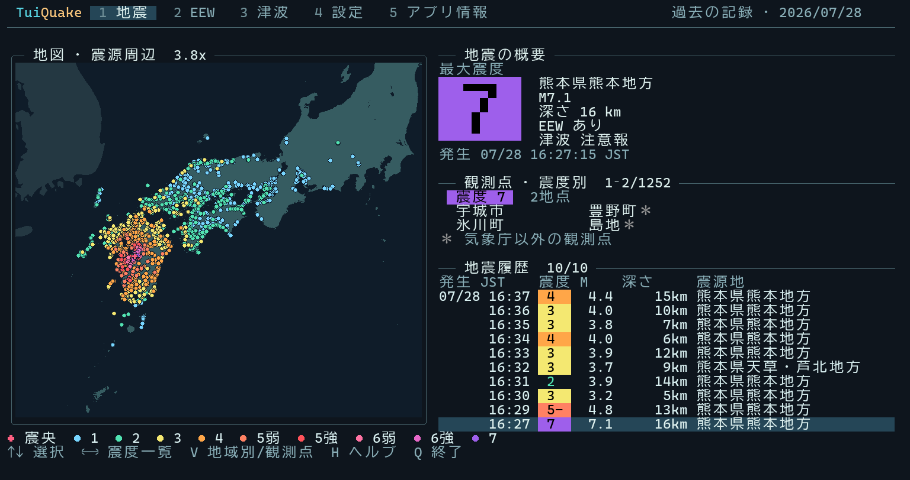
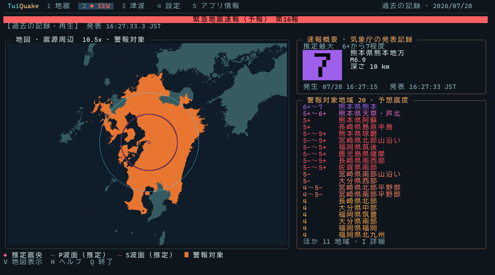
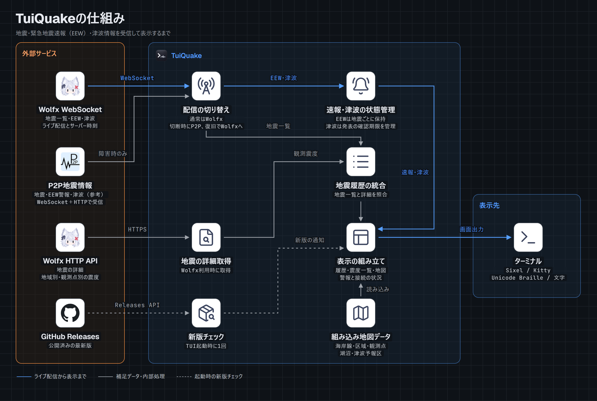

# TuiQuake

<p> </p>

日本の地震情報、緊急地震速報、津波情報をターミナルエミュレーター(以後ターミナルと呼ぶ)上で確認できます。

[](https://github.com/hirokawa-beach/TuiQuake/actions/workflows/ci.yml)
[](LICENSE)
[](https://github.com/hirokawa-beach/TuiQuake/releases)

> **非公式の閲覧用アプリです。** 配信や通信による遅延・欠落があります。防災時は気象庁・自治体の公式情報を確認してください。

> [!IMPORTANT]
> Unicode Brailleと文字地図は表示調整中です。地図を見るときは、SixelまたはKittyの画像描画に対応したターミナルでの利用を推奨します。 [画像対応ターミナル](#必要な環境)

## 目次

- [画面例](#画面例)
- [特長](#特長)
- [導入方法](#導入方法)
  - [更新を確認する](#更新を確認する)
  - [ダウンロードしたファイルを検証する](#ダウンロードしたファイルを検証する)
- [必要な環境](#必要な環境)
- [主なキー](#主なキー)
- [設定](#設定)
- [仕組みとデータ](#仕組みとデータ)
- [ソースからビルド](#ソースからビルド)
- [困ったときは⋯](#トラブルシュート)
- [English](#english)
- [ライセンスとデータの出典](#ライセンスとデータの出典)

## 画面例

<a href="docs/media/earthquakes-regions.png"></a>

_表示している地震は過去のものです。

**参考資料**　[気象庁の震度データベース](https://www.data.jma.go.jp/eqdb/data/shindo/index.html#20260728162715) / [令和8年熊本地震ポータル](https://www.jma.go.jp/jma/menu/20260728_kumamoto_jishin.html) / [気象庁の区域一覧](https://www.jma.go.jp/jma/kishou/know/jishin/joho/shindo-name.html)

<details>
<summary>観測点ごとの震度を見る</summary>

<a href="docs/media/earthquakes.png"></a>

地震タブで `V` を押すと、地域別と観測点別の表示を切り替えられます。

</details>

<details>
<summary>令和8年熊本地震のEEWを再生（第24報まで）</summary>

<a href="docs/media/eew-demo.mp4"></a>

[EEWの再生動画を開く（MP4・約32秒）](docs/media/eew-demo.mp4)

水色のP波面とピンクのS波面は、気象庁の発表記録とJMA2001走時表を使って再現しています。

[気象庁の予報記録](https://ds.data.jma.go.jp/eew/data/nc/fc_hist/2026/07/20260728162718/index.html) · [気象庁の警報記録](https://www.data.jma.go.jp/eew/data/nc/pub_hist/2026/07/20260728162718/reachtime/reachtime.html)

</details>

## 特長

- **地震履歴を見る。** 履歴から選んだ地震の震源と各地の震度を確認できます。地域ごとの最大震度と観測点ごとの記録を切り替えられます。
- **緊急地震速報（EEW）の更新を追う。** 受信した予報と警報を表示します。地図は警報の対象地域と地域ごとの推定震度を切り替えられます。
- **津波情報を確認する。** 大津波警報、津波警報、注意報、予報を沿岸線の色で示します。地域ごとの波高や第1波の見込みは、地図の横の一覧で確認できます。
- **軽い** TUIをRustで実装し、メモリ/CPU使用量を抑えています。

## 導入方法

配布先は GitHub Releases です。OSとCPUに合うファイルを選んでください。 [ダウンロード](https://github.com/hirokawa-beach/TuiQuake/releases) · [ソースからビルド](#ソースからビルド)

### Windows（MSI）

`tuiquake-{version}-windows-x86_64.msi` を開いてインストールします。新しいターミナルで `tuiquake` と入力してください。削除する場合は、Windowsの「インストールされているアプリ」からアンインストールできます。

> [!NOTE]
> Windows向けの `.msi` と `.exe` は未署名です。起動時にMicrosoft Defender SmartScreenの警告が出る場合があります。

### Linux（Ubuntu・Debian向けの .deb）

64ビットOSと `libc6 2.34` 以上が必要です。Raspberry Pi OSではBookworm以降の64ビット版を使ってください。

x86-64は `tuiquake_{version}_amd64.deb`、ARM64は `tuiquake_{version}_arm64.deb` をダウンロードします。保存先のフォルダで次を実行してください。コマンドがCPUに合うファイル名を選びます。

```bash
sudo apt install "./tuiquake_{version}_$(dpkg --print-architecture).deb"
tuiquake
```

アンインストールは `sudo apt remove tuiquake` で行えます。

### macOS（Homebrew）

Intel・Apple Siliconともに同じ手順です。Homebrew 5以前では `brew trust` の行を省いてください。初回はソースからビルドします。

```bash
brew tap hirokawa-beach/tuiquake https://github.com/hirokawa-beach/TuiQuake.git
brew trust --formula hirokawa-beach/tuiquake/tuiquake
brew install hirokawa-beach/tuiquake/tuiquake
tuiquake
```

<details>
<summary>macOS用の .pkg を使う</summary>

Intel Macは `tuiquake-{version}-macos-x86_64.pkg`、Apple Silicon Macは `tuiquake-{version}-macos-aarch64.pkg` を開きます。インストール後はターミナルで `tuiquake` と入力してください。

`.pkg` は未署名・未公証です。

</details>

<details>
<summary>インストールせずに実行ファイルを使う</summary>

ダウンロードしたファイルの保存先で起動します。Linux・macOSでは実行権限を付けてから起動します。

- **Windows x86-64（PowerShell）** — `.\tuiquake-{version}-windows-x86_64.exe`
- **Linux x86-64・ARM64** — `chmod +x ./tuiquake-{version}-linux-$(uname -m) && ./tuiquake-{version}-linux-$(uname -m)`
- **macOS Intel** — `chmod +x ./tuiquake-{version}-macos-x86_64 && ./tuiquake-{version}-macos-x86_64`
- **macOS Apple Silicon** — `chmod +x ./tuiquake-{version}-macos-aarch64 && ./tuiquake-{version}-macos-aarch64`

</details>

### 更新を確認する

起動時にGitHub Releasesで新版を1回確認します。新版があると「5 アプリ情報」に `↑更新` のステータスが付きます。タブを開いて Enter を押すと、ブラウザーでリリースページが開かれますので、アップデートしてください。

### ダウンロードしたファイルを検証する

配布ファイルと同じリリースの `SHA256SUMS.txt` を、同じフォルダに保存します。

- **Windows（PowerShell）** — MSIなら `Get-FileHash -Algorithm SHA256 .\tuiquake-0.1.0-windows-x86_64.msi`、EXEなら `Get-FileHash -Algorithm SHA256 .\tuiquake-0.1.0-windows-x86_64.exe` を実行します。表示された値を `SHA256SUMS.txt` の同じファイル名の行と照合します。ハッシュの英字は大文字・小文字を区別しません。
- **Linux** — `sha256sum --ignore-missing -c SHA256SUMS.txt`
- **macOS** — `shasum -a 256 -c --ignore-missing SHA256SUMS.txt`

Linux・macOSでは、一致したファイルの横に `OK` と表示されます。

## 必要な環境
~~TUIが表示できる(ANSI制御に対応した対話型の)ターミナルで使用できます。~~  もちろん、インターネット接続も必要です。  
Braille及び文字での地図表示は現在調整中です。画像描画に対応したターミナルを推奨します。

画像地図を表示するには、SixelまたはKittyの画像描画に対応したターミナルが必要です。

作者が(画像描画含め)動作を確認した端末は次の3件です。

| OS | ターミナル |
| --- | --- |
| Windows | [Windows Terminal](https://learn.microsoft.com/ja-jp/windows/terminal/) |
| Raspberry Pi OS | [foot](https://codeberg.org/dnkl/foot) |
| Raspberry Pi OS | [Rio Terminal](https://rioterm.com/) |

macOSは ~~作者が林檎信者ではないので~~ 実機確認ができていません。各端末のSixel・Kitty対応は[画像描画対応ターミナル一覧](docs/terminals.md)にまとめています。

起動画面に表示された描画方式を選んでください。

## 主なキー

| 操作                                        | キー                                            |
| ------------------------------------------- | ----------------------------------------------- |
| タブ移動                                    | 1 地震 / 2 EEW / 3 津波 / 4 設定 / 5 アプリ情報 |
| 地震履歴を選ぶ / 各地の震度をスクロール     | `↑` `↓` / `←` `→`                               |
| 地図を移動 / 拡大・縮小                     | `W` `A` `S` `D` / `+` `−`                       |
| 地震の震度表示を切り替え（地域別 / 観測点） | `V`                                             |
| 同時に出ているEEWから地図に表示する速報を選ぶ | `↑` `↓`                                        |
| EEWの地図を切り替え（警報対象 / 推定震度）  | `V`                                             |
| 津波の地図を切り替え（全国 / 対象沿岸）     | `Z`                                             |
| 文字で詳細を表示                            | `I`                                             |
| 今のタブの操作を確認                        | `H`                                             |
| 終了の確認を開く                            | `Q`（`Y` で終了、`N` / `Esc` で戻る）              |

狭い端末では `B` で地震履歴と地図を切り替えられます。

## 設定

`4` で設定を開き、`↑` `↓` で項目を選びます。`←` `→` または `Space` で値を変更すると、アプリが自動で保存します。

- 描画方式を「自動」にすると、次の起動時に選択画面が開きます。方式を指定するとその場で切り替わります。起動時に地図をどの範囲で開くかも設定できます。
- 震度は初期設定で観測点を震度別に表示します。都道府県別にまとめたり、地域別の表示に切り替えたりできます。
- 地震履歴の初期値は10行です。5 / 10 / 20 / 30行、または端末の高さに合わせる「自動」を選べます。
- EEWの端末ベルを有効にすると、初報を受信したときと警報に切り替わったときに端末へベルを送ります。設定行の `Enter` で試し鳴らしができます。音や通知の出方は端末の設定に従います。

ライブEEWの予報円を描くための発生時刻・震央・深さと基準時刻は、すべてWolfxの配信から取得します。Wolfxのサーバー時刻から地震発生後の経過時間を求め、気象庁のJMA2001走時表を使って、現在時点のP波・S波の推定波面を円で描きます。 [気象庁のJMA2001走時表](https://www.data.jma.go.jp/eqev/data/bulletin/catalog/appendix/trtime/trt_j.html)

取消報、PLUM法による仮定震源、深さや時刻を確認できない速報では円を表示しません。

設定の「デモ」から、Wolfxが公開しているEEWの応答例10件と津波情報の応答例8件を試せます。例を選ぶと公開サンプルを読み込み、過去の資料として表示します。`I` で応答のJSONを確認できます。地震詳細のサンプルと架空のEEWリプレイも選べます。 [Wolfx Open APIの応答例](https://wolfx.jp/docs/open-api/)

架空のEEWデモでは、P波とS波の広がりを円で表示します。気象庁の解説にあるおおよその速さ（P波は秒速7 km、S波は秒速4 km）を使ったデモ用の概算です。 [気象庁「緊急地震速報のしくみ」](https://www.jma.go.jp/jma/kishou/know/jishin/eew/shikumi/shikumi.html)

## 仕組みとデータ



画面右上に接続先、最後の応答時刻、EEWと津波の取得状況を表示します。

### 配信元

| 用途 | 配信元と接続方式 |
| --- | --- |
| 地震一覧・EEW・津波情報 | WolfxのWebSocket |
| 地震の詳細 | WolfxのHTTP API |
| ライブ配信が途切れたとき | P2P地震情報。EEWは警報を受信します。 |

Wolfxが復旧すると、元の配信へ戻ります。

### 緊急地震速報（EEW）

- 配信元のサーバー時刻を基準に、発表から120秒未満の報を表示します。
- 一度警報が出ると、同じ地震の予報が続いても赤い帯と警報対象地域が残ります。
- 別の地震の速報が重なったときは、先に出た速報を画面上部に残します。`↑` `↓` で地図に表示する速報を選べます。
- 地図は `V` で警報対象と推定震度を切り替えられます。推定震度は気象庁の配信値です。
- 震度に幅があるときは上限を、下限だけが示されたときはその下限を地図の色に使います。受信した範囲は一覧で確認できます。
- 速報概要の推定最大震度も、幅があるときは上限をバッジに使います。
- 地図を「震源周辺」にすると、対象が収まる範囲で最大約10.5倍まで自動で拡大します。

予報と警報の発表条件は、気象庁の解説を参照してください。 [緊急地震速報の発表基準](https://www.jma.go.jp/jma/kishou/know/jishin/eew/shikumi/shousai.html)


### 津波情報

- 全国66の津波予報区のうち、確認期限内の発表がある沿岸を色分けします。 [気象庁の津波予報区](https://www.jma.go.jp/jma/kishou/know/jishin/joho/tsunami-yohoku.html)
- 一覧では発表区分と地域名も同じ色で示し、波高と第1波の見込みを表示します。
- `Z` で全国と対象沿岸を切り替えます。
- 確認期限切れの情報やP2Pの参考情報では、沿岸線は通常の色で表示します。

| 発表区分 | 色 |
| --- | --- |
| 大津波警報 | 紫 |
| 津波警報 | 赤 |
| 津波注意報 | 黄 |
| 津波予報(若干の海面変動) | 水色 |

## ソースからビルド

[Git](https://git-scm.com/install/) と **Rust 1.88以上**を用意します。バージョンは `rustc --version` で確認できます。OSのパッケージが古い場合は rustup を使ってください。 [Rustのインストール](https://rust-lang.org/tools/install/)

Windows は [Visual Studio C++ Build Tools](https://visualstudio.microsoft.com/visual-cpp-build-tools/)、Ubuntu は `build-essential`、macOS は Xcode Command Line Tools（`xcode-select --install`）も必要です。

```bash
git clone https://github.com/hirokawa-beach/TuiQuake.git
cd TuiQuake
cargo build --release --locked
```

Windows の PowerShell では `.\target\release\tuiquake.exe`、Linux / macOS では `./target/release/tuiquake` で起動します。

<details>
<summary>コマンドで直接表示する（開発者向け）</summary>

| コマンド                   | 表示内容                                                      |
| -------------------------- | ------------------------------------------------------------- |
| `latest`                   | 最新の地震                                                    |
| `eew` / `replay --history` | 最新の緊急地震速報1報（P2P切り替え時は警報）                  |
| `replay --delay 4`         | 架空の地震と速報のデモを4秒間隔で表示。オフラインでも利用可能 |
| `watch`                    | 地震と緊急地震速報を受信し次第更新                            |

```powershell
.\target\release\tuiquake.exe latest --japan
```

```bash
./target/release/tuiquake latest --japan
```

`--japan` は全国表示です。`--map sixel` / `--map kitty` / `--map braille` / `--map text` で描画方式を指定できます。ファイルやパイプに出力するときは、既定で文字地図（text）を使います。

</details>

## トラブルシュート

### 地図に隙間が出る、文字の桁がずれる

Windows Terminalでは、「設定 → 使用中のプロファイル → 外観 → フォント フェイス」を開き、まず既定の `Cascadia Mono` を選んでください。日本語の字形はターミナルが別のフォントで補います。 [Windows Terminalの外観設定](https://learn.microsoft.com/ja-jp/windows/terminal/customize-settings/profile-appearance)

日本語を含む等幅フォントも選べます。  
[等幅フォント例]
- **BIZ UDGothic** — Windowsでインストール済みなら、そのまま選べます。 [BIZ UDGothicの情報](https://learn.microsoft.com/ja-jp/typography/font-list/biz-udgothic)
- **HackGen Console** — Windows Terminalで日本語と罫線を揃えたいときの候補です。半角と全角が1:2になる、名前に `35` が付かない版を選んでください。 [HackGenの公式配布](https://github.com/yuru7/HackGen/releases/latest)
- **Noto Sans Mono CJK JP** — footで動作を確認しています。Windows Terminalでは「非等幅フォント」と表示され、表示が崩れます。 [Noto CJKの公式配布](https://github.com/notofonts/noto-cjk)

### 地図が「画像で」表示されない

ターミナルが Sixel または Kitty に対応しているか確認してください。設定画面の地図表示方法、もしくは`--map text` で文字地図を選べます。文字地図と Unicode Braille は現状非推奨(調整中)です。この2方式では観測点の震度は一覧に表示されます。

### 不具合を報告/新機能の提案

バグの報告や新機能の提案等々、大歓迎です！  
バグ報告の場合は「5 アプリ情報」で確認できるバージョン、端末、描画方式と、問題が出たときの操作を添えてください。 [GitHub Issues](https://github.com/hirokawa-beach/TuiQuake/issues)

## English

Download the package for your operating system and CPU from [GitHub Releases](https://github.com/hirokawa-beach/TuiQuake/releases), then follow the [installation guide](#導入方法).

TuiQuake is a Japanese-language terminal app for browsing earthquakes, station-level seismic intensity, earthquake early warnings, and tsunami bulletins. It offers Sixel, Kitty, and text maps.  
It is an unofficial viewer. For safety decisions, consult official information from the JMA or local authorities.

## ライセンスとデータの出典

TuiQuakeのオリジナルコードは [GNU General Public License v3.0](LICENSE)（GPL-3.0-only）です。配布バイナリの依存ライブラリのライセンスは [THIRD_PARTY_NOTICES.txt](THIRD_PARTY_NOTICES.txt) に記載しています。

| データ | 提供元 | 規約 |
| --- | --- | --- |
| P波・S波の走時表 | 気象庁のJMA2001走時表をTuiQuake用に変換（[走時表の出典](https://www.data.jma.go.jp/eqev/data/bulletin/catalog/appendix/trtime/trt_j.html)） | [気象庁の利用規約](https://www.jma.go.jp/jma/kishou/info/coment.html) |
| 地震・EEW・津波 | Wolfx Project（[WebSocket][wolfx-ws] / [Open API][wolfx-api]） | [利用規約][wolfx-terms] |
| 予備配信 | [P2P地震情報 API][p2p-api] | [二次利用ガイドライン][p2p-terms] |
| 震度観測点・細分区域 | 気象庁（[観測点一覧][jma-stations] / [細分区域のGISデータ][jma-gis]） | [利用規約][jma-terms] |
| 津波予報区 | 気象庁（[予報区の案内][jma-tsunami] / [沿岸線GeoJSON][jma-tsunami-json]） | [利用規約][jma-terms] |
| 湖沼 | 国土交通省（[国土数値情報 W09・平成17年版][mlit-lakes]） | [利用規約][mlit-terms] |
| 周辺陸地 | [Natural Earth 1:50m Land][natural-land] | [利用条件（パブリックドメイン）][natural-terms] |

[wolfx-ws]: https://wolfx.jp/docs/websocket/
[wolfx-api]: https://wolfx.jp/docs/open-api/
[wolfx-terms]: https://wolfx.jp/legal/terms/
[p2p-api]: https://www.p2pquake.net/develop/json_api_v2/
[p2p-terms]: https://www.p2pquake.net/secondary_use/
[jma-stations]: https://www.data.jma.go.jp/eqev/data/bulletin/shindo.html
[jma-gis]: https://www.data.jma.go.jp/developer/gis.html
[jma-terms]: https://www.jma.go.jp/jma/kishou/info/coment.html
[jma-tsunami]: https://www.jma.go.jp/jma/kishou/know/jishin/joho/tsunami-yohoku.html
[jma-tsunami-json]: https://www.jma.go.jp/bosai/common/const/geojson/tsunami.json
[mlit-lakes]: https://nlftp.mlit.go.jp/ksj/gml/datalist/KsjTmplt-W09-v2_2.html
[mlit-terms]: https://nlftp.mlit.go.jp/ksj/other/agreement_02.html
[natural-land]: https://www.naturalearthdata.com/downloads/50m-physical-vectors/50m-land/
[natural-terms]: https://www.naturalearthdata.com/about/terms-of-use/

<details>
<summary>地図データの加工内容</summary>

- `data/stations.json` には震度観測点一覧から抽出した名前と座標を収録。位置情報のない観測点は文字詳細に表示。
- `data/regions.json` には地震情報の細分区域の名称・コード・ポリゴンを収録しています。共有境界をまとめて簡略化し、細い隙間を補正しています。ごく小さな島の輪郭は省略。
- `data/tsunami_coasts.json` には津波予報区の区域コードと沿岸線を収録。
- `data/lakes.json` には、面積10 km²以上の湖沼の輪郭を簡略化して収録。
- `data/surroundings.json` には、東経110〜159度・北緯18〜55度の陸地を収録。

元の地図と利用上の注意は公開元のページに記載されています。 [気象庁の予報区等GISデータ一覧][jma-gis]

</details>

<details>
<summary>地図データを再生成する（開発者向け）</summary>

通常のビルドでは `data/` の地図データを使います。再生成するには、気象庁の一覧で「地震情報／細分区域」を選び、湖沼データと津波予報区の `tsunami.json` も取得します。 [気象庁の予報区等GISデータ一覧][jma-gis] [国土交通省の湖沼データ][mlit-lakes] [気象庁の津波予報区GeoJSON][jma-tsunami-json]

Python 3.11以上とNode.js 20.11以上で、リポジトリのルートから次のコマンドを実行します。

```powershell
npm install --no-save --no-package-lock --ignore-scripts mapshaper@0.8.1
python tools/prepare_regions.py 20240520_AreaForecastLocalE_GIS.zip data/regions.json
python tools/prepare_lakes.py W09-05_GML.zip data/lakes.json
python tools/prepare_tsunami.py tsunami.json data/tsunami_coasts.json
```

</details>
