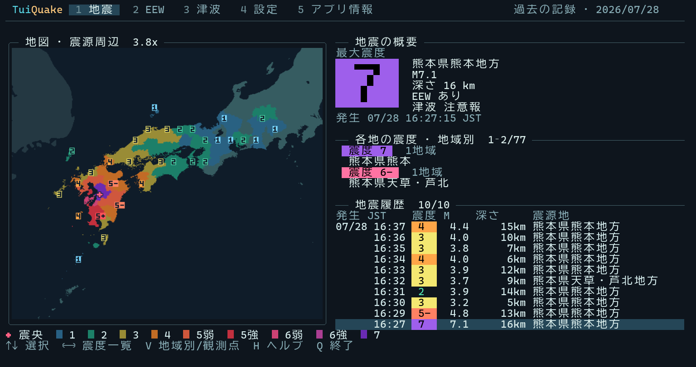

# TuiQuake


日本の地震情報、緊急地震速報、津波情報をターミナルで確認できます。

[](https://github.com/hirokawa-beach/TuiQuake/actions/workflows/ci.yml)
[](LICENSE)
[](https://github.com/hirokawa-beach/TuiQuake/releases)

> **非公式の閲覧用アプリです。** 配信や通信による遅延・欠落があります。防災時は気象庁・自治体の公式情報を確認してください。

> [!NOTE]
> Unicode Brailleと文字地図は表示調整中です。地図を見るときは、SixelまたはKittyの画像描画に対応したターミナルでの利用を推奨します。 [対応ターミナル](#必要な環境)

## 目次

- [画面例](#画面例)
- [特長](#特長)
- [クイックスタート](#クイックスタート)
  - [ダウンロードしたファイルを検証する](#ダウンロードしたファイルを検証する)
- [必要な環境](#必要な環境)
- [主なキー](#主なキー)
- [設定](#設定)
- [仕組みとデータ](#仕組みとデータ)
- [ソースからビルド](#ソースからビルド)
- [トラブルシュート](#トラブルシュート)
- [English](#english)
- [ライセンスとデータの出典](#ライセンスとデータの出典)

## 画面例

<a href="docs/media/earthquakes-regions.png"></a>

_表示している地震は過去のものです。_

2026年7月28日の令和8年熊本地震です。

**参考資料**　[気象庁の震度データベース](https://www.data.jma.go.jp/eqdb/data/shindo/index.html#20260728162715) / [令和8年熊本地震ポータル](https://www.jma.go.jp/jma/menu/20260728_kumamoto_jishin.html) / [気象庁の区域一覧](https://www.jma.go.jp/jma/kishou/know/jishin/joho/shindo-name.html)

<details>
<summary>観測点ごとの震度を見る</summary>

<a href="docs/media/earthquakes.png"></a>

地図の点は本震で震度1〜7を観測した1,252地点です。地震タブで `V` を押すと、地域別と観測点別の表示を切り替えられます。

</details>

<details>
<summary>令和8年熊本地震のEEWを再生（第24報まで）</summary>

[EEWの再生動画を開く（MP4・32.2秒）](docs/media/eew-demo.mp4)

</details>

## 特長

- **地震履歴を見る。** 履歴から選んだ地震の震源と各地の震度を確認できます。地域ごとの最大震度と観測点ごとの記録を切り替えられます。
- **緊急地震速報（EEW）の更新を追う。** 受信した予報と警報を表示します。地図は警報の対象地域と地域ごとの推定震度を切り替えられます。
- **津波情報を確認する。** 大津波警報、津波警報、注意報、予報を沿岸線の色で示します。地域ごとの波高や第1波の見込みは、地図の横の一覧で確認できます。

## クイックスタート

配布先は GitHub Releases です。OSとCPUに合うファイルを選んでください。以下は v0.1.0 のファイル名です。 [ダウンロード](https://github.com/hirokawa-beach/TuiQuake/releases) · [ソースからビルド](#ソースからビルド)

### Windows（MSI）

`tuiquake-0.1.0-windows-x86_64.msi` を開いてインストールします。新しいターミナルで `tuiquake` と入力してください。削除する場合は、Windowsの「インストールされているアプリ」からアンインストールできます。

> [!NOTE]
> Windows向けの `.msi` と `.exe` は未署名です。起動時にMicrosoft Defender SmartScreenの警告が出る場合があります。 [SmartScreenの説明](https://learn.microsoft.com/en-us/windows/security/threat-protection/microsoft-defender-smartscreen/microsoft-defender-smartscreen-overview)

### Linux（Ubuntu・Debian向けの .deb）

x86-64は `tuiquake_0.1.0_amd64.deb`、ARM64は `tuiquake_0.1.0_arm64.deb` をダウンロードします。保存先のフォルダで次を実行してください。コマンドがCPUに合うファイル名を選びます。

```bash
sudo apt install "./tuiquake_0.1.0_$(dpkg --print-architecture).deb"
tuiquake
```

アンインストールは `sudo apt remove tuiquake` で行えます。

### macOS（Homebrew）

Intel・Apple Siliconともに同じ手順です。Homebrew 5以前では `brew trust` の行を省いてください。初回はソースからビルドします。

```bash
brew tap hirokawa-beach/tuiquake https://github.com/hirokawa-beach/TuiQuake.git
brew trust --formula hirokawa-beach/tuiquake/tuiquake
brew install hirokawa-beach/tuiquake/tuiquake
tuiquake
```

<details>
<summary>macOS用の .pkg を使う</summary>

Intel Macは `tuiquake-0.1.0-macos-x86_64.pkg`、Apple Silicon Macは `tuiquake-0.1.0-macos-aarch64.pkg` を開きます。インストール後はターミナルで `tuiquake` と入力してください。

`.pkg` は未署名・未公証です。macOSに開くのを止められた場合はHomebrewを使えます。

</details>

<details>
<summary>インストールせずに実行ファイルを使う</summary>

ダウンロードしたファイルの保存先で起動します。Linux・macOSでは実行権限を付けてから起動します。

- **Windows x86-64（PowerShell）** — `.\tuiquake-0.1.0-windows-x86_64.exe`
- **Linux x86-64・ARM64** — `chmod +x ./tuiquake-0.1.0-linux-$(uname -m) && ./tuiquake-0.1.0-linux-$(uname -m)`
- **macOS Intel** — `chmod +x ./tuiquake-0.1.0-macos-x86_64 && ./tuiquake-0.1.0-macos-x86_64`
- **macOS Apple Silicon** — `chmod +x ./tuiquake-0.1.0-macos-aarch64 && ./tuiquake-0.1.0-macos-aarch64`

</details>

### ダウンロードしたファイルを検証する

配布ファイルと同じリリースの `SHA256SUMS.txt` を、同じフォルダに保存します。

- **Windows（PowerShell）** — MSIなら `Get-FileHash -Algorithm SHA256 .\tuiquake-0.1.0-windows-x86_64.msi`、EXEなら `Get-FileHash -Algorithm SHA256 .\tuiquake-0.1.0-windows-x86_64.exe` を実行します。表示された値を `SHA256SUMS.txt` の同じファイル名の行と照合します。ハッシュの英字は大文字・小文字を区別しません。
- **Linux** — `sha256sum --ignore-missing -c SHA256SUMS.txt`
- **macOS** — `shasum -a 256 -c --ignore-missing SHA256SUMS.txt`

Linux・macOSでは、一致したファイルの横に `OK` と表示されます。

## 必要な環境

画像地図を表示するには、SixelまたはKittyの画像描画に対応したターミナルが必要です。ライブ配信の受信にはインターネット接続も必要です。

作者が動作を確認した端末は次の3件です。

| OS | ターミナル |
| --- | --- |
| Windows | [Windows Terminal](https://learn.microsoft.com/ja-jp/windows/terminal/) |
| Raspberry Pi OS | [foot](https://codeberg.org/dnkl/foot) |
| Raspberry Pi OS | [Rio Terminal](https://rioterm.com/) |

macOSは作者による実機確認ができていません。各端末のSixel・Kitty対応は別ページにまとめています。 [ターミナルの画像描画方式](docs/terminals.md)

起動画面に表示された描画方式を選んでください。画像描画が検出されない場合は、Unicode Braille（表示調整中）で起動できます。

## 主なキー

| 操作                                        | キー                                            |
| ------------------------------------------- | ----------------------------------------------- |
| タブ移動                                    | 1 地震 / 2 EEW / 3 津波 / 4 設定 / 5 アプリ情報 |
| 地震履歴を選ぶ / 各地の震度をスクロール     | `↑` `↓` / `←` `→`                               |
| 地図を移動 / 拡大・縮小                     | `W` `A` `S` `D` / `+` `−`                       |
| 地震の震度表示を切り替え（地域別 / 観測点） | `V`                                             |
| EEWの地図を切り替え（警報対象 / 推定震度）  | `V`                                             |
| 津波の地図を切り替え（全国 / 対象沿岸）     | `Z`                                             |
| 文字で詳細を表示                            | `I`                                             |
| 今のタブの操作を確認 / 終了                 | `H` / `Q`                                       |

狭い端末では `B` で地震履歴と地図を切り替えられます。

## 設定

`4` で設定を開き、`↑` `↓` で項目を選びます。`←` `→` または `Space` で値を変更すると、アプリが自動で保存します。

- 描画方式を「自動」にすると、次の起動時に選択画面が開きます。方式を指定するとその場で切り替わります。起動時に地図をどの範囲で開くかも設定できます。
- 震度は初期設定で観測点を震度別に表示します。都道府県別にまとめたり、地域別の表示に切り替えたりできます。
- 地震履歴の初期値は10行です。5 / 10 / 20 / 30行、または端末の高さに合わせる「自動」を選べます。
- EEWの端末ベルを有効にすると、初報を受信したときと警報に切り替わったときに端末へベルを送ります。設定行の `Enter` で試し鳴らしができます。音や通知の出方は端末の設定に従います。

## 仕組みとデータ

画面右上に接続先、最後の応答時刻（JST）、EEWと津波の状況を表示します。

### 配信元

| 用途 | 配信元と接続方式 |
| --- | --- |
| 地震一覧・EEW・津波情報 | WolfxのWebSocket |
| 地震の詳細 | WolfxのHTTP API |
| ライブ配信が途切れたとき | P2P地震情報。EEWは警報を受信します。 |

Wolfxが復旧すると、元の配信へ戻ります。

### 緊急地震速報（EEW）

- 配信元のサーバー時刻を基準に、発表から120秒未満の報を表示します。
- 一度警報が出ると、その後の予報でも赤い帯と警報対象地域が残ります。
- 警報の続報で対象地域を追加します。取消報を受けると警報表示を消します。
- 地図は `V` で警報対象と推定震度を切り替えられます。推定震度は気象庁の配信値です。
- 震度に幅があるときは上限を、下限だけが示されたときはその下限を地図の色に使います。受信した範囲は一覧で確認できます。
- 速報概要の推定最大震度も、幅があるときは上限をバッジに使います。
- 地図を「震源周辺」にすると、対象が収まる範囲で最大約10.5倍まで自動で拡大します。

予報と警報の発表条件は、気象庁の解説を参照してください。 [緊急地震速報の発表基準](https://www.jma.go.jp/jma/kishou/know/jishin/eew/shikumi/shousai.html)

地震動の予報業務許可の制度は、気象庁のFAQで確認できます。 [地震動の予報業務許可に関するFAQ](https://www.jma.go.jp/jma/kishou/minkan/q_a_s.html)

### 津波情報

- 全国66の津波予報区のうち、確認期限内の発表がある沿岸を色分けします。 [気象庁の津波予報区](https://www.jma.go.jp/jma/kishou/know/jishin/joho/tsunami-yohoku.html)
- 一覧では発表区分と地域名も同じ色で示し、波高と第1波の見込みを表示します。
- `Z` で全国と対象沿岸を切り替えます。
- 確認期限切れの情報やP2Pの参考情報では、沿岸線は通常の色で表示します。

| 発表区分 | 色 |
| --- | --- |
| 大津波警報 | 紫 |
| 津波警報 | 赤 |
| 津波注意報 | 黄 |
| 津波予報 | 水色 |

## ソースからビルド

[Git](https://git-scm.com/install/) と **Rust 1.88以上**を用意します。バージョンは `rustc --version` で確認できます。OSのパッケージが古い場合は rustup を使ってください。 [Rustのインストール](https://rust-lang.org/tools/install/)

Windows は [Visual Studio C++ Build Tools](https://visualstudio.microsoft.com/visual-cpp-build-tools/)、Ubuntu は `build-essential`、macOS は Xcode Command Line Tools（`xcode-select --install`）も必要です。

```bash
git clone https://github.com/hirokawa-beach/TuiQuake.git
cd TuiQuake
cargo build --release --locked
```

Windows の PowerShell では `.\target\release\tuiquake.exe`、Linux / macOS では `./target/release/tuiquake` で起動します。

<details>
<summary>コマンドで直接表示する（開発者向け）</summary>

| コマンド                   | 表示内容                                                      |
| -------------------------- | ------------------------------------------------------------- |
| `latest`                   | 最新の地震                                                    |
| `eew` / `replay --history` | 最新の緊急地震速報1報（P2P切り替え時は警報）                  |
| `replay --delay 4`         | 架空の地震と速報のデモを4秒間隔で表示。オフラインでも利用可能 |
| `watch`                    | 地震と緊急地震速報を受信し次第更新                            |

```powershell
.\target\release\tuiquake.exe latest --japan
```

```bash
./target/release/tuiquake latest --japan
```

`--japan` は全国表示です。`--map sixel` / `--map kitty` / `--map braille` / `--map text` で描画方式を指定できます。ファイルやパイプに出力するときは、既定で文字地図（text）を使います。

</details>

## トラブルシュート

### 地図に隙間が出る、文字の桁がずれる

Windows Terminalでは「設定 → プロファイル → 既定値 → 外観」で「フォント フェイス」に `Cascadia Mono` を指定できます。 [Windows Terminalの外観設定](https://learn.microsoft.com/ja-jp/windows/terminal/customize-settings/profile-appearance)

日本語と半角文字の桁がずれるときは、日本語を含む等幅フォントの `Noto Sans Mono CJK JP` を試してください。 [Noto Sans CJK のダウンロード案内](https://github.com/notofonts/noto-cjk/tree/main/Sans#language-specific-otfs)

### 画像地図が表示されない

端末が Sixel または Kitty に対応しているか確認してください。`--map text` で文字地図を選べます。文字地図と Unicode Braille は非推奨です。この2方式では観測点の震度は一覧に表示されます。

### 不具合を報告する

「5 アプリ情報」で確認できるバージョン、端末、描画方式と、問題が出たときの操作を添えてください。 [GitHub Issues](https://github.com/hirokawa-beach/TuiQuake/issues)

## English

Download the package for your operating system and CPU from [GitHub Releases](https://github.com/hirokawa-beach/TuiQuake/releases), then follow the [quick start](#クイックスタート).

TuiQuake is a Japanese-language terminal app for browsing earthquakes, station-level seismic intensity, earthquake early warnings, and tsunami bulletins. It offers Sixel, Kitty, and text maps.  
It is an unofficial viewer. For safety decisions, consult official information from the JMA or local authorities.

## ライセンスとデータの出典

TuiQuakeのオリジナルコードは [GNU General Public License v3.0](LICENSE)（GPL-3.0-only）です。配布バイナリの依存ライブラリのライセンスは [THIRD_PARTY_NOTICES.txt](THIRD_PARTY_NOTICES.txt) に記載しています。

| データ | 提供元 | 規約 |
| --- | --- | --- |
| 地震・EEW・津波 | Wolfx Project（[WebSocket][wolfx-ws] / [Open API][wolfx-api]） | [利用規約][wolfx-terms] |
| 予備配信 | [P2P地震情報 API][p2p-api] | [二次利用ガイドライン][p2p-terms] |
| 震度観測点・細分区域 | 気象庁（[観測点一覧][jma-stations] / [細分区域のGISデータ][jma-gis]） | [利用規約][jma-terms] |
| 津波予報区 | 気象庁（[予報区の案内][jma-tsunami] / [沿岸線GeoJSON][jma-tsunami-json]） | [利用規約][jma-terms] |
| 湖沼 | 国土交通省（[国土数値情報 W09・平成17年版][mlit-lakes]） | [利用規約][mlit-terms] |
| 周辺陸地 | [Natural Earth 1:50m Land][natural-land] | [利用条件（パブリックドメイン）][natural-terms] |

[wolfx-ws]: https://wolfx.jp/docs/websocket/
[wolfx-api]: https://wolfx.jp/docs/open-api/
[wolfx-terms]: https://wolfx.jp/legal/terms/
[p2p-api]: https://www.p2pquake.net/develop/json_api_v2/
[p2p-terms]: https://www.p2pquake.net/secondary_use/
[jma-stations]: https://www.data.jma.go.jp/eqev/data/bulletin/shindo.html
[jma-gis]: https://www.data.jma.go.jp/developer/gis.html
[jma-terms]: https://www.jma.go.jp/jma/kishou/info/coment.html
[jma-tsunami]: https://www.jma.go.jp/jma/kishou/know/jishin/joho/tsunami-yohoku.html
[jma-tsunami-json]: https://www.jma.go.jp/bosai/common/const/geojson/tsunami.json
[mlit-lakes]: https://nlftp.mlit.go.jp/ksj/gml/datalist/KsjTmplt-W09-v2_2.html
[mlit-terms]: https://nlftp.mlit.go.jp/ksj/other/agreement_02.html
[natural-land]: https://www.naturalearthdata.com/downloads/50m-physical-vectors/50m-land/
[natural-terms]: https://www.naturalearthdata.com/about/terms-of-use/

<details>
<summary>地図データの加工内容</summary>

- `stations.json` には震度観測点一覧から抽出した名前と座標を収録しています。位置情報のない観測点は文字詳細に表示します。
- `regions.json` には地震情報の細分区域の名称・コード・ポリゴンを収録しています。共有境界をまとめて簡略化し、細い隙間を補正しています。ごく小さな島の輪郭は省略しています。
- `tsunami_coasts.json` には津波予報区の区域コードと沿岸線を収録しています。
- 湖沼は面積10 km²以上を抽出し、輪郭を簡略化しています。整備時点と現在の湖岸線には差がある場合があります。
- 周辺陸地は、東経110〜159度・北緯18〜55度を切り出しています。

元の地図と利用上の注意は公開元のページに記載されています。 [気象庁の予報区等GISデータ一覧][jma-gis]

</details>

<details>
<summary>地図データを再生成する（開発者向け）</summary>

通常のビルドではリポジトリに含まれる地図データを使います。再生成するには、気象庁の一覧で「地震情報／細分区域」を選び、湖沼データと津波予報区の `tsunami.json` も取得します。 [気象庁の予報区等GISデータ一覧][jma-gis] [国土交通省の湖沼データ][mlit-lakes] [気象庁の津波予報区GeoJSON][jma-tsunami-json]

Python 3.11以上とNode.js 20.11以上で、リポジトリのルートから次のコマンドを実行します。

```powershell
npm install --no-save --no-package-lock --ignore-scripts mapshaper@0.8.1
python tools/prepare_regions.py 20240520_AreaForecastLocalE_GIS.zip regions.json
python tools/prepare_lakes.py W09-05_GML.zip lakes.json
python tools/prepare_tsunami.py tsunami.json tsunami_coasts.json
```

</details>
