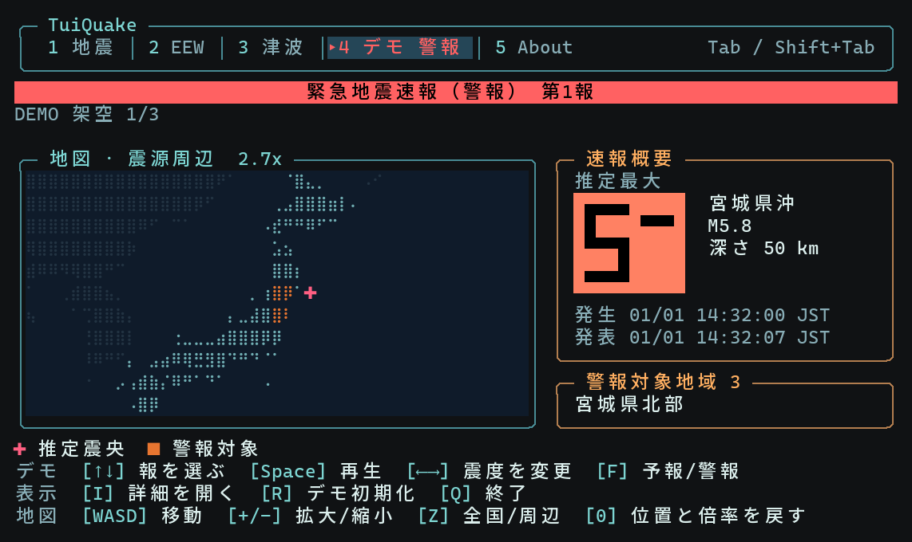

# TuiQuake

日本で起きた地震を履歴から選び、**震源と各地の震度を地図で確認**できるターミナルアプリです。緊急地震速報（EEW）と津波情報も、タブを切り替えて見られます。

[起動する](#起動する) · [地震を調べる](#地震を調べる) · [速報と津波情報を見る](#速報と津波情報を見る)



*デモの警報画面。地震、震度、警報対象地域は架空の例です。*

## 起動する

Windows Terminal の PowerShell で、ソースを取得してビルドします。準備するのは [Git](https://git-scm.com/install/windows)、[Rust](https://rust-lang.org/tools/install/)、[Visual Studio C++ Build Tools](https://visualstudio.microsoft.com/visual-cpp-build-tools/) です。

```powershell
git clone https://github.com/hirokawa-beach/TuiQuake.git
cd TuiQuake
cargo build --release --locked
.\target\release\tuiquake.exe
```

起動すると地図の描画方式を選べます。迷ったら **Unicode Braille** を選んで `Enter`。端末が対応していれば、Sixel や Kitty の画像描画も選べます。

まず画面を試すなら、**`4` でデモを開いて `Space`**。架空の速報が順に表示されます。`F` で予報と警報を切り替えられます。

## 地震を調べる

1. **`1` で地震タブ**を開きます。右側の地震履歴を `↑` `↓` で選ぶと、地図と概要が切り替わります。
2. **`Enter` で震源周辺へ**。地図の `✚` が震央です。`W` `A` `S` `D` で移動し、`+` `-` で拡大・縮小できます。
3. **`V` で震度表示を切り替え**ます。「広域」は地域ごとの最大震度、「観測点」は地点ごとの震度です。`I` を押すと、地域名・観測点名と震度を文字で確認できます。

端末の幅が狭いときは、`B` で地震履歴と地図を行き来できます。震度の `5-` / `5+` は **5弱 / 5強**、`6-` / `6+` は **6弱 / 6強** です。

<details>
<summary>ほかのキー操作</summary>

| したいこと | キー |
|---|---|
| タブを移動する | `1` 地震、`2` EEW、`3` 津波、`4` デモ、`5` About。`Tab` / `Shift+Tab` でも移動 |
| 各地の震度一覧をスクロールする | `←` / `→`（地震タブ） |
| 文字詳細・津波情報をスクロールする | `↑` / `↓` |
| 文字詳細から地図へ戻る | `I` / `B` |
| 全国と震源周辺を切り替える | `Z` |
| 地図の位置と倍率を戻す | `0` |
| 地震・津波情報を更新する | `R` |
| デモで報を選ぶ・推定最大震度を変更する | `↑` / `↓` で報を選択。EEWの報では `←` / `→` で震度を変更 |
| デモを初期化する | `R`（デモタブ） |
| 終了する | `Q` |

</details>

## 速報と津波情報を見る

- **`2` 緊急地震速報** — 受信中の速報を表示します。見出しは**予報が黄色、警報が赤**。報数と推定最大震度を確認でき、警報時は対象地域も地図に表示します。他のタブを開いていても速報は受信し、上部のメニューに知らせます。
- **`3` 津波情報** — 津波警報・注意報・予報の状況を表示します。発表データに含まれていれば、対象地域や第1波の見込みも確認できます。

> TuiQuake は非公式の閲覧用アプリです。配信や通信による遅延・欠落があるため、防災時は気象庁や自治体の公式情報を確認してください。

<details>
<summary>コマンドで直接表示する・描画方式を指定する</summary>

`tuiquake.exe` の後ろに、見たい情報に合わせてコマンドを指定します。

| コマンド | 表示内容 |
|---|---|
| `latest` | 最新の地震 |
| `eew` | Wolfx の最新の緊急地震速報1報 |
| `replay` | 架空の地震と速報のデモ。オフラインで実行でき、`--delay 4` で4秒間隔に変更 |
| `replay --history` | `eew` と同じ最新1報 |
| `watch` | 最新の情報を約10秒ごとに取得・表示 |

```powershell
.\target\release\tuiquake.exe latest --japan
.\target\release\tuiquake.exe --map braille
```

`--japan` は全国表示。描画方式は `--map sixel` / `--map kitty` / `--map braille` / `--map text` から指定できます。`text` は4分割ブロックの文字地図です。直接表示のコマンドは端末に合わせて描画方式を選び、ファイルやパイプに出力するときは既定で `text` を使います。

</details>

## ライセンスとデータの出典

TuiQuake のオリジナルコードは [GNU General Public License v3.0](LICENSE)（GPL-3.0-only）です。Windows 版の依存ライブラリのライセンスは [THIRD_PARTY_NOTICES.txt](THIRD_PARTY_NOTICES.txt) に掲載しています。

- **地震・EEW・津波情報** — データ提供 Wolfx Project。気象庁発表の情報を [Wolfx Open API](https://wolfx.jp/docs/open-api/) 経由で取得します。データを使う機能は無償で提供します。 [Wolfx Project の利用規約](https://wolfx.jp/legal/terms/)
- **震度観測点と区域** — 気象庁の [震度観測点一覧](https://www.data.jma.go.jp/eqev/data/bulletin/shindo.html) と [予報区等GISデータ「地震情報／細分区域」](https://www.data.jma.go.jp/developer/gis.html) を TuiQuake が加工しました。 [気象庁ホームページの利用規約](https://www.jma.go.jp/jma/kishou/info/coment.html)
- **湖沼** — 国土交通省の [国土数値情報（湖沼データ W09、平成17年版）](https://nlftp.mlit.go.jp/ksj/gml/datalist/KsjTmplt-W09-v2_2.html) から面積10 km²以上の湖沼を抽出し、TuiQuake が輪郭を簡略化しました。整備時点と現在の湖岸線には差がある場合があります。「商用可」の条件が適用されます。 [国土数値情報の利用規約](https://nlftp.mlit.go.jp/ksj/other/agreement_02.html)
- **周辺陸地** — [Natural Earth 1:50m Land](https://www.naturalearthdata.com/downloads/50m-physical-vectors/50m-land/) のうち、東経110〜159度・北緯18〜55度の範囲を TuiQuake が切り出しました。 [Natural Earth の利用条件（パブリックドメイン）](https://www.naturalearthdata.com/about/terms-of-use/)
- **ロゴ** — Glenn Chappell の [FIGlet Slant](https://www.figlet.org/cgi-bin/fontdb_example.cgi?font=slant.flf) で生成した文字列を TuiQuake が色付けしています。

<details>
<summary>気象庁の地図データの加工内容と承認番号</summary>

`stations.json` は、震度観測点一覧から名前と座標を抽出したものです。位置情報のない観測点は文字詳細に表示します。`regions.json` は、地震情報の細分区域の名称・コードとポリゴンを収録しています。共有境界をまとめて簡略化し、細い隙間を補正し、ごく小さな島の輪郭は省略しています。

気象庁のGISデータ一覧に記載された国土地理院の元データは、数値地図25000（空間データ基盤）、数値地図（国土基本情報）、電子国土基本図（地図情報）です。掲載の承認番号は、平30情使 第401号、令2情使 第125号、令3情使 第90号、令3情使 第123号、令3情使 第648号、令4情使 第437号、令5情使 第71号、令6情使 第382号、令7情使 第395号です。

</details>

<details>
<summary>地図データを再生成する（開発者向け）</summary>

通常のビルドではリポジトリに含まれる地図データを使います。再生成する場合は、気象庁の [地震情報／細分区域のZIP](https://www.data.jma.go.jp/developer/gis/20240520_AreaForecastLocalE_GIS.zip) と国土交通省の [湖沼データのZIP](https://nlftp.mlit.go.jp/ksj/gml/datalist/KsjTmplt-W09-v2_2.html) を取得し、Python 3.11以上とNode.js 20.11以上で次を実行します。

```powershell
npm install --no-save --no-package-lock --ignore-scripts mapshaper@0.8.1
python tools/prepare_regions.py 20240520_AreaForecastLocalE_GIS.zip regions.json
python tools/prepare_lakes.py W09-05_GML.zip lakes.json
```

</details>
