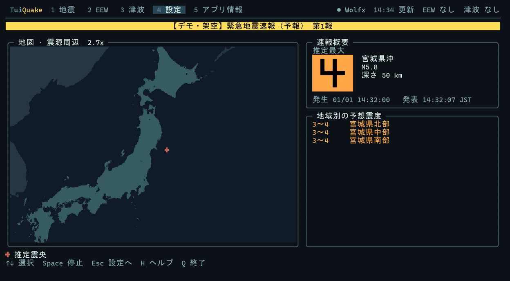

# TuiQuake


**ターミナルで見る、日本の地震と緊急地震速報。**

[](https://github.com/hirokawa-beach/TuiQuake/actions/workflows/ci.yml)
[](LICENSE)
[](https://github.com/hirokawa-beach/TuiQuake/releases)

> **非公式の閲覧用アプリです。** 配信や通信による遅延・欠落があります。防災時は気象庁・自治体の公式情報を確認してください。


*地震タブの画面例。表示している地震は架空です。*

<details>
<summary>EEW警報デモを見る</summary>



</details>

## 特長

- **地震履歴を地図で見る。** 地震を選ぶと震源と各地の震度が切り替わります。
- **観測点まで確認する。** 震度別・都道府県別の観測点一覧と、地域ごとの最大震度を切り替えられます。
- **緊急地震速報と津波情報を受信する。** 速報は予報と警報を色分けし、他のタブでも通知します。
- **端末に合わせて地図を描く。** Sixel と Kitty の画像描画に対応しています。

## クイックスタート

[Releases](https://github.com/hirokawa-beach/TuiQuake/releases) に公開済みのバイナリがあれば、OSとCPUに合うファイルをダウンロードします。リリースがまだない場合は[ソースからビルド](#ソースからビルド)してください。

| 環境 | ファイル |
| --- | --- |
| Windows（x86-64） | `tuiquake-windows-x86_64.exe` |
| Linux（x86-64 / ARM64） | `tuiquake-linux-x86_64` / `tuiquake-linux-aarch64` |
| macOS（Intel / Apple Silicon） | `tuiquake-macos-x86_64` / `tuiquake-macos-aarch64` |

ダウンロード先のディレクトリでファイルを実行します。以下は x86-64 の例です。

**Windows の PowerShell**

```powershell
.\tuiquake-windows-x86_64.exe
```

**Linux**

```bash
chmod +x ./tuiquake-linux-x86_64
./tuiquake-linux-x86_64
```

macOS でも、自分の機種用のファイル名で同じ手順を実行できます。

地図の描画方式を選んだら、**4 で設定を開き、「EEWデモ」を選んで Enter** を押します。Space で再生、F で予報と警報を切り替え、Esc で設定に戻れます。H で操作を確認できます。

## 必要な環境

- **Windows** — Windows Terminal と等幅フォントの Cascadia Mono が出発点です。 [Windows Terminal の外観設定](https://learn.microsoft.com/ja-jp/windows/terminal/customize-settings/profile-appearance)
- **Linux / macOS** — 画像地図には Kitty など、画像プロトコルに対応したターミナルを使えます。 [Kitty のグラフィックスプロトコル](https://sw.kovidgoyal.net/kitty/graphics-protocol.html)
- **共通** — 日本語を表示できる等幅フォントと、ライブ配信を受信するためのインターネット接続が必要です。地図の描画方式は端末の検出結果に合わせて選べます。

## 主なキー

| 操作 | キー |
| --- | --- |
| タブ移動 | 1 地震 / 2 EEW / 3 津波 / 4 設定 / 5 アプリ情報 |
| 履歴を選択・各地の震度をスクロール | ↑ ↓ / ← → |
| 地図の移動・拡縮 | W A S D / + − |
| 地域別・観測点を切り替え・文字詳細を開く | V / I |
| タブごとのヘルプ・終了 | H / Q |

狭い端末では、B で地震履歴と地図を切り替えられます。震度の 5- / 5+ は 5弱 / 5強、6- / 6+ は 6弱 / 6強です。

## 設定

4 で設定を開き、↑ ↓ で項目を選びます。← → または Space で変更すると自動で保存されます。

- **地図** — 描画方式の「自動」は次の起動時に選択画面を開きます。固定の描画方式を選ぶとその場で切り替わります。起動時の範囲も設定できます。
- **震度** — 初期値は観測点の震度別表示です。地域別表示と、都道府県別の観測点表示も選べます。
- **履歴** — 初期値は10行です。5 / 10 / 20 / 30行、または端末の高さに合わせる「自動」を選べます。
- **EEWの端末ベル** — 初報や警報への切り替わりに端末へベルを送ります。設定行で Enter を押すと試し鳴らしできます。音や通知の挙動は端末の設定に従います。

## 仕組みとデータ

上部のステータスで接続先、最後の応答時刻（JST）、EEW・津波の状況が分かります。

- **配信** — 地震一覧・EEW・津波情報は Wolfx の WebSocket、地震詳細は Wolfx の HTTP API から取得します。ライブ配信が途切れると P2P地震情報へ切り替え、Wolfx の復旧時に戻ります。P2P の EEW は警報が対象です。
- **EEW** — 配信元のサーバー時刻で発表から120秒未満の報を表示します。地域別の推定震度が届いた場合は一覧で確認でき、警報対象は地図にも表示します。
- **津波** — Wolfx の発表は配信確認期限まで現況として表示します。期限の経過後と、P2P への切り替え中は現況未確認と表示します。届いた発表は対象地域や第1波の見込みを確認できます。

## ソースからビルド

[Git](https://git-scm.com/install/) と [Rust](https://rust-lang.org/tools/install/) を用意します。Windows は [Visual Studio C++ Build Tools](https://visualstudio.microsoft.com/visual-cpp-build-tools/)、Ubuntu は `build-essential`、macOS は Xcode Command Line Tools（`xcode-select --install`）も必要です。

```bash
git clone https://github.com/hirokawa-beach/TuiQuake.git
cd TuiQuake
cargo build --release --locked
```

Windows の PowerShell では `.\target\release\tuiquake.exe`、Linux / macOS では `./target/release/tuiquake` で起動します。

<details>
<summary>コマンドで直接表示する</summary>

| コマンド | 表示内容 |
| --- | --- |
| `latest` | 最新の地震 |
| `eew` / `replay --history` | 最新の緊急地震速報1報（P2P切り替え時は警報） |
| `replay --delay 4` | 架空の地震と速報のデモを4秒間隔で表示。オフラインでも利用可能 |
| `watch` | 地震と緊急地震速報を受信し次第更新 |

```powershell
.\target\release\tuiquake.exe latest --japan
```

```bash
./target/release/tuiquake latest --japan
```

`--japan` は全国表示です。`--map sixel` / `--map kitty` / `--map braille` / `--map text` で描画方式を指定できます。ファイルやパイプに出力するときは、既定で文字地図（text）を使います。

</details>

## トラブルシュート

- **地図に隙間が出る、文字の桁がずれる** — 等幅フォントを使い、日本語のフォールバックと端末の文字間隔を確認してください。 日本語の等幅フォントには Noto Sans Mono CJK JP も使えます。 [Noto Sans CJK のダウンロード案内](https://github.com/notofonts/noto-cjk/tree/main/Sans#language-specific-otfs)
- **画像地図が表示されない** — 端末の Sixel / Kitty 対応を確認してください。`--map text` で文字地図を選べます。文字地図と Unicode Braille は非推奨です。この2方式では観測点の震度を一覧で確認できます。
- **不具合を報告する** — 「5 アプリ情報」のバージョン、端末、描画方式と、問題が出たときの操作を添えてください。 [GitHub Issues](https://github.com/hirokawa-beach/TuiQuake/issues)

## English

TuiQuake is a Japanese-language terminal app for browsing earthquakes, station-level seismic intensity, earthquake early warnings, and tsunami bulletins. It offers Sixel, Kitty, and text maps. It is an unofficial viewer. For safety decisions, consult official information from the Japan Meteorological Agency or local authorities.

## ライセンスとデータの出典

TuiQuake のオリジナルコードは [GNU General Public License v3.0](LICENSE)（GPL-3.0-only）です。配布バイナリの依存ライブラリのライセンスは [THIRD_PARTY_NOTICES.txt](THIRD_PARTY_NOTICES.txt) に掲載しています。

- **地震・EEW・津波** — データ提供 Wolfx Project。気象庁発表の情報を [Wolfx WebSocket](https://wolfx.jp/docs/websocket/) と [Wolfx Open API](https://wolfx.jp/docs/open-api/) 経由で取得します。データを使う機能は無償で提供します。 [Wolfx Project の利用規約](https://wolfx.jp/legal/terms/)
- **予備配信** — P2P地震情報。 [P2P地震情報 API](https://www.p2pquake.net/develop/json_api_v2/) [二次利用ガイドライン](https://www.p2pquake.net/secondary_use/)
- **震度観測点と区域** — 気象庁の [震度観測点一覧](https://www.data.jma.go.jp/eqev/data/bulletin/shindo.html) と [予報区等GISデータ「地震情報／細分区域」](https://www.data.jma.go.jp/developer/gis.html) を TuiQuake が加工しました。 [気象庁ホームページの利用規約](https://www.jma.go.jp/jma/kishou/info/coment.html)
- **湖沼** — 国土交通省の [国土数値情報（湖沼データ W09、平成17年版）](https://nlftp.mlit.go.jp/ksj/gml/datalist/KsjTmplt-W09-v2_2.html) から面積10 km²以上の湖沼を抽出し、TuiQuake が輪郭を簡略化しました。整備時点と現在の湖岸線には差がある場合があります。「商用可」の条件が適用されます。 [国土数値情報の利用規約](https://nlftp.mlit.go.jp/ksj/other/agreement_02.html)
- **周辺陸地** — [Natural Earth 1:50m Land](https://www.naturalearthdata.com/downloads/50m-physical-vectors/50m-land/) のうち、東経110〜159度・北緯18〜55度の範囲を TuiQuake が切り出しました。 [Natural Earth の利用条件（パブリックドメイン）](https://www.naturalearthdata.com/about/terms-of-use/)
- **ロゴ** — Glenn Chappell の [FIGlet Slant](https://www.figlet.org/cgi-bin/fontdb_example.cgi?font=slant.flf) で生成した文字列を TuiQuake が色付けしています。

<details>
<summary>気象庁の地図データの加工内容と承認番号</summary>

`stations.json` は、震度観測点一覧から名前と座標を抽出したものです。位置情報のない観測点は文字詳細に表示します。`regions.json` は、地震情報の細分区域の名称・コードとポリゴンを収録しています。共有境界をまとめて簡略化し、細い隙間を補正し、ごく小さな島の輪郭は省略しています。

気象庁のGISデータ一覧に記載された国土地理院の元データは、数値地図25000（空間データ基盤）、数値地図（国土基本情報）、電子国土基本図（地図情報）です。掲載の承認番号は、平30情使 第401号、令2情使 第125号、令3情使 第90号、令3情使 第123号、令3情使 第648号、令4情使 第437号、令5情使 第71号、令6情使 第382号、令7情使 第395号です。

</details>

<details>
<summary>地図データを再生成する（開発者向け）</summary>

通常のビルドではリポジトリに含まれる地図データを使います。再生成する場合は、気象庁の [地震情報／細分区域のZIP](https://www.data.jma.go.jp/developer/gis/20240520_AreaForecastLocalE_GIS.zip) と国土交通省の [湖沼データのZIP](https://nlftp.mlit.go.jp/ksj/gml/datalist/KsjTmplt-W09-v2_2.html) を取得し、Python 3.11以上とNode.js 20.11以上で次を実行します。

```powershell
npm install --no-save --no-package-lock --ignore-scripts mapshaper@0.8.1
python tools/prepare_regions.py 20240520_AreaForecastLocalE_GIS.zip regions.json
python tools/prepare_lakes.py W09-05_GML.zip lakes.json
```

</details>
